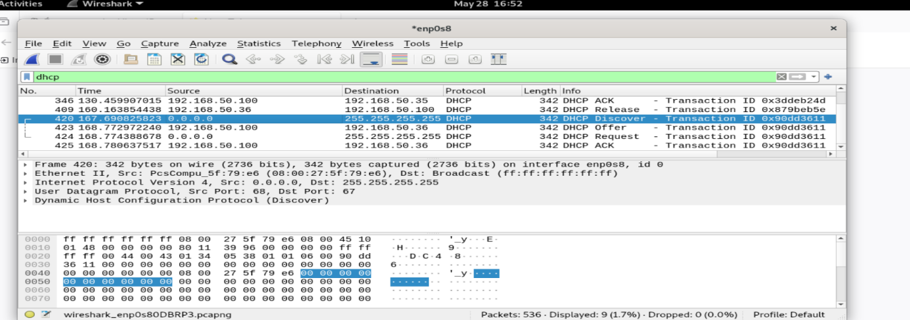
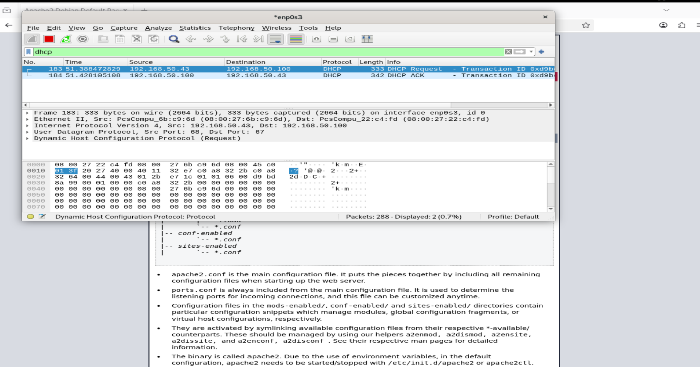
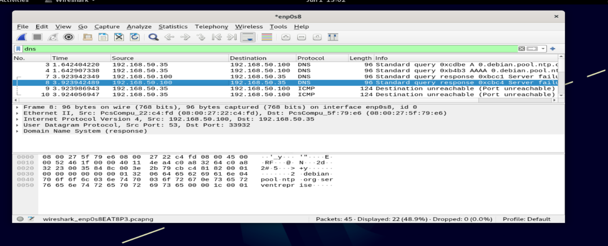
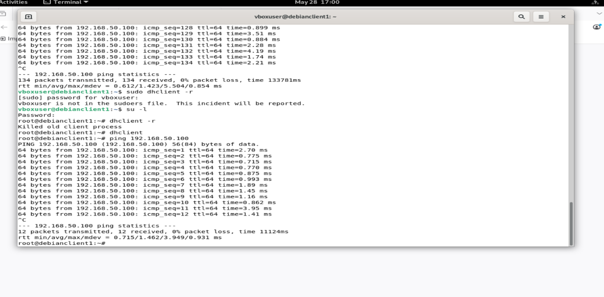
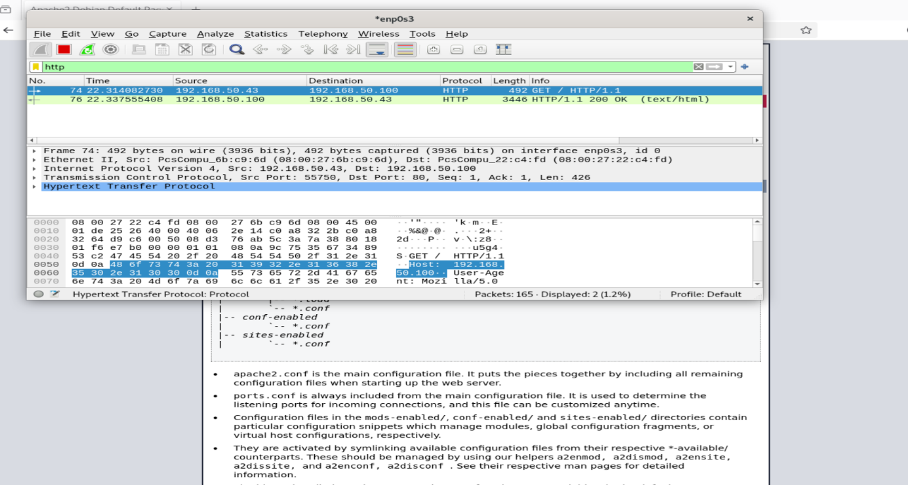
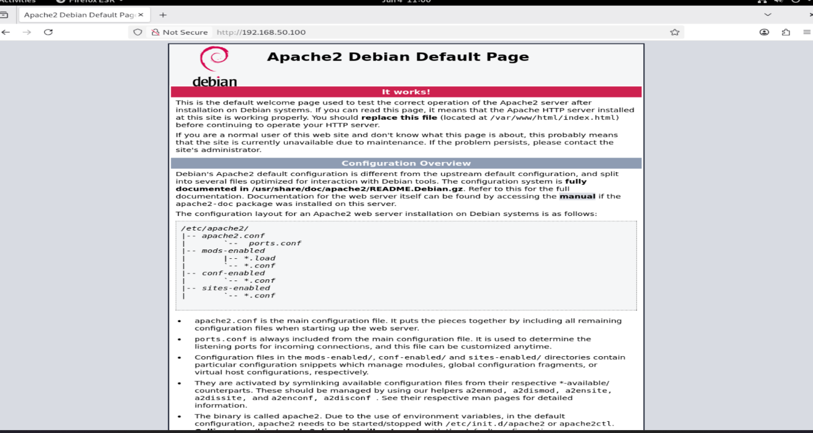

# Infrastructure réseau sous Debian : DHCP, DNS, FTP, HTTP

Laboratoire réalisé sous VirtualBox dans le cadre de ma formation au CNAM (NFA077 – Technologie informatique et réseaux).

## Objectif

Mettre en place un petit réseau d'entreprise avec un serveur Debian (**ServEntreprise**) qui fournit quatre services à deux postes clients :

| Service | Rôle | Logiciel |
|---|---|---|
| DHCP | Attribution automatique des adresses IP | isc-dhcp-server |
| DNS | Résolution des noms de machines | bind9 |
| FTP | Transfert de fichiers | vsftpd |
| HTTP | Serveur web | apache2 |

Les échanges de chaque protocole sont ensuite analysés avec **Wireshark**.

## Architecture

- Réseau : `192.168.50.0/24`
- VirtualBox : mode **Réseau interne**, nom du réseau `serventreprise` (identique sur les trois machines)

| Machine | Nom | Adresse IP |
|---|---|---|
| Serveur | ServEntreprise | 192.168.50.100 (statique) |
| Client 1 | Debianclient1 | 192.168.50.35 (DHCP) |
| Client 2 | Debianclient2 | 192.168.50.43 (DHCP) |

## Étapes de réalisation

### 1. Adresse IP statique du serveur
Vérification de l'interface avec `ip a` (interface `enp0s8`), puis configuration de l'adresse dans `/etc/network/interfaces` et redémarrage. Résultat : `192.168.50.100/24`.

### 2. Serveur DHCP
```bash
apt update
apt install isc-dhcp-server
nano /etc/default/isc-dhcp-server     # INTERFACESv4="enp0s8"
nano /etc/dhcp/dhcpd.conf             # définition de la plage d'adresses
systemctl restart isc-dhcp-server
systemctl enable isc-dhcp-server
systemctl status isc-dhcp-server      # service actif
```

### 3. Clients en DHCP
Dans `/etc/network/interfaces` de chaque client :
```
auto enp0s8
iface enp0s8 inet dhcp
```
Renouvellement du bail puis vérification avec `ip a` :
```bash
dhclient -r
dhclient
```
Les clients obtiennent bien `192.168.50.35` et `192.168.50.43`.

### 4. Test de connectivité
Ping serveur ↔ clients et client ↔ client : **0 % de perte**.

### 5. Serveur DNS
```bash
apt install bind9
nano /etc/bind/named.conf.local       # déclaration de la zone
cp /etc/bind/db.local /etc/bind/db.entreprise
nano /etc/bind/db.entreprise          # enregistrements de la zone
systemctl restart bind9
```
Sur les clients, `/etc/resolv.conf` :
```
nameserver 192.168.50.100
search entreprise.local
```
Test : `ping debianclient2.entreprise.local`.

### 6. Serveur FTP
```bash
apt install vsftpd
systemctl restart vsftpd
systemctl enable vsftpd
adduser ftpuser
```
Test depuis un client avec FileZilla : envoi (`put test.txt`) et téléchargement (`get test.txt`) réussis.

### 7. Serveur HTTP
```bash
apt install apache2
systemctl restart apache2
systemctl enable apache2
nano /var/www/html/index.html         # <h1>Bienvenue sur ServEntreprise</h1>
```
Accès depuis un client : `http://192.168.50.100`.

## Analyse avec Wireshark

| Protocole | Filtre | Échanges observés |
|---|---|---|
| DHCP | `dhcp` | Discover → Offer → Request → ACK |
| DNS | `dns` | Requêtes (Query) et réponses (Response) |
| FTP | `ftp` | USER, PASS, STOR, RETR |
| HTTP | `http` | GET / puis HTTP/1.1 200 OK |

### Captures

**DHCP – Discover / Offer / Request / ACK**





**DNS**



**Test de connectivité**



**HTTP**





## Difficultés rencontrées et solutions

| Problème | Cause | Solution |
|---|---|---|
| Aucune adresse DHCP attribuée | Mauvaise interface réseau configurée | Vérification des interfaces avec `ip a` |
| Machines qui ne communiquent pas | Mauvaise configuration du réseau interne VirtualBox | Même nom de réseau interne sur les trois machines |
| Résolution DNS en échec | Erreur dans le fichier de zone | Relecture et correction de `db.entreprise` |
| « Destination Host Unreachable » aux premiers tests | Configuration réseau incorrecte | Contrôle des adresses IP et des fichiers de configuration |

## Ce que j'ai appris

- Configurer des services réseau de base sous Debian (DHCP, DNS, FTP, HTTP).
- Lire et analyser des trames avec Wireshark pour comprendre le fonctionnement réel des protocoles.
- Diagnostiquer une panne réseau étape par étape (interface, adresse, service, fichier de configuration).

## Pistes d'amélioration

- Remplacer FTP par SFTP ou FTPS, car FTP transmet les identifiants en clair.
- Mettre en place un pare-feu sur le serveur.
- Ajouter une résolution DNS inverse.

## Outils

Debian · VirtualBox · isc-dhcp-server · bind9 · vsftpd · apache2 · FileZilla · Wireshark
